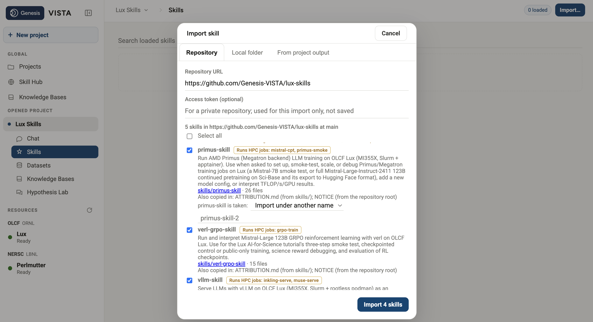

# Lux LLM training, post-training, serving and agents

This tutorial follows an LLM from training to scientific agents on **Lux**, the OLCF
cluster with 8 AMD Instinct MI355X GPUs (288 GB each) per node. Four skills in the
[central Lux Skills repository](https://github.com/Genesis-VISTA/lux-skills) cover the stages:

| Stage | Skill | What it does |
|---|---|---|
| 1. Continued pretraining | [`primus-skill`](https://github.com/Genesis-VISTA/lux-skills/tree/main/skills/primus-skill) | Adapts **Mistral-Large-Instruct-2411 (123B)** to scientific text with AMD Primus; includes a Mistral-7B smoke test. |
| 2. RL post-training | [`verl-grpo-skill`](https://github.com/Genesis-VISTA/lux-skills/tree/main/skills/verl-grpo-skill) | Trains the 123B model with GRPO and a verifiable science-answer reward. |
| 3. Model serving | [`vllm-skill`](https://github.com/Genesis-VISTA/lux-skills/tree/main/skills/vllm-skill) | Serves an OpenAI-compatible endpoint and runs science benchmarks; the ready-to-run example serves Inkling-MXFP4. |
| 4. Scientific agents | [`autogen-skill`](https://github.com/Genesis-VISTA/lux-skills/tree/main/skills/autogen-skill) | Runs four AutoGen agents that optimize an ICF capsule against a vLLM endpoint, or serves gpt-oss-20b in the job. |

Import the repository **once** in VISTA before starting any stage. For a hand run,
clone it once and use the wrappers in `skills/<skill>/`. Both routes submit Lux jobs
and read their results. The examples below are measured Lux runs from October 2026.

The stages form a workflow, but their ready-to-run examples are separate experiments:
GRPO starts from the shared original Mistral 123B model, not automatically from a
Primus CPT checkpoint; the serving and agent examples use Inkling unless you select
another endpoint. Sections 2 and 3 explain how to use and evaluate your own checkpoints.

## Before you start

You need:

- **An OLCF account on Lux** with a Slurm allocation. Lux rejects jobs without `-A`.
  The skills pick up your first account automatically. To use another, `export
  ACCOUNT=<proj>`.
- **To run from VISTA:** Lux connected in VISTA (your Lux account set in **Settings →
  Compute**, and your RSA SecurID token for the login), and a project to import the
  skills into. [Create your own ModSim skill](modsim-skill.md#what-a-modsim-skill-is)
  explains how imported skills run jobs.
- **To run by hand:** a shell on the Lux login node, `login1.lux.olcf.ornl.gov`.
- **Nothing to download for the default runs.** The models, containers and datasets
  are in a shared package that the skills read in place:

| `/lustre/orion/world-shared/stf218/junqi/Genesis-Hackathon/...` | Used by | Size |
|---|---|---|
| `models/mistral_large_megatron_tp1pp8/` | Primus CPT starting checkpoint | 448 GB |
| `models/Mistral-Large-Instruct-2411/` | Mistral 123B HF starting model for GRPO; CPT tokenizer and export reference | 224 GB |
| `datasets/scibase_*`, `datasets/chatmix_v7/` | CPT (34B Sci-Base tokens, 1.98M chat conversations) | |
| `containers/primus_v26.5.sif` | CPT image (apptainer) | |
| `containers/verl_v26.8A.sif` | GRPO image (apptainer) | about 12 GB |
| `datasets/sci_rl/{rl_control,rl_pubonly,sci_dev}.parquet` | GRPO training and dev data | 41,091 / 41,091 / 1,200 rows |
| `models/Inkling-MXFP4/` | default vLLM serving | 517 GB |
| `models/gptoss-20b-hedp.03302026/` | agents with `BACKEND=self` | 39 GB |
| `containers/inference_image_gfx950_v8mi250_20261011.tar` | serving and benchmark image (podman) | 56 GB |
| `datasets/benchmarks/science/` | GPQA Diamond, MaScQA, MMLU-Pro evaluation | 28 MB |

`MANIFEST.sha256` checks the package's original assets. The added GRPO image
and prepared parquets were compared with the source package when copied.

**To use VISTA,** open your project, select **Skills** → **Import…** →
**Repository**, and enter `https://github.com/Genesis-VISTA/lux-skills` as the
repository URL. VISTA lists the skills it finds. Select `primus-skill`,
`verl-grpo-skill`, `vllm-skill` and `autogen-skill`, then select
**Import 4 skills**. The repository also contains `parallel-attention-skill`,
which this tutorial does not use. Check the four imported cards for the jobs
named in each part below.



If VISTA says a skill name is taken, resolve that choice before importing.
Importing under another name changes the `<skill>/<job>` identifier used in
the examples below.

**To run by hand,** clone the repository once on Lustre:

```bash
cd /lustre/orion/<proj>/scratch/$USER
git clone https://github.com/Genesis-VISTA/lux-skills
export LUX_SKILLS="$PWD/lux-skills"
```

!!! note "These jobs take real time"
    The CPT test holds 4 nodes for about 8 minutes of job time; the GRPO smoke test
    uses 8 nodes and has taken 23 minutes in a healthy run; the Inkling benchmark
    holds 2 nodes for about an hour. Queue time comes first (`squeue -u $USER`).
    Submitting returns at once, so you need not keep the shell or conversation open.

## Part 1. Continue pretraining with `primus-skill`

Primus is AMD's training framework for Instinct GPUs. Here it runs Megatron-LM inside an
apptainer container across nodes. The skill wraps two workloads: a quick Mistral-7B
smoke test, and continued pretraining (CPT) of Mistral-Large-123B, adapted from tutorial
3 of the Lux AI-for-Science hackathon.

```bash
cd "$LUX_SKILLS/skills/primus-skill"
source env.lux.sh            # account, image, shared package, proxy, network interface
```

### 1.1 Smoke test: Mistral-7B on one node

The smoke test checks that your account, the image and the GPUs work before you spend
node-hours on the big model. It trains Mistral-7B-v0.3 in BF16 on mock data for 20
iterations.

```bash
scripts/setup.sh             # once: clone Primus release/v26.5 and build its helpers (~minutes)
scripts/run_smoke.sh 1       # 1 node, ~3 minutes including startup
cat runs/<jobid>/summary.txt
```

A healthy run exits 0 after 20 of 20 iterations with falling loss. Expect these speeds:

| Nodes | Global batch | Steady TFLOP/s/GPU | Step time |
|---|---|---|---|
| 1 | 256 | ~944 | 3.25 s |
| 2 | 512 | ~810 | 3.78 s |

Keep the per-GPU batch fixed when you compare node counts (`scripts/run_smoke.sh 2
GLOBAL_BATCH_SIZE=512`). Halving it costs about 27% per GPU, which is a batch-size
effect, not a scaling one. Mock data is memorized, so a loss near 0 is expected and says
nothing about model quality.

### 1.2 Continued pretraining of Mistral-Large-123B

This continues pretraining **Mistral-Large-Instruct-2411** on **Sci-Base**, a corpus of
scientific text, mixed with 10% chat and tool-calling conversations. The model is
trained in FP8, laid out as TP1 × PP8: each node holds one full copy of the model, split
across its 8 GPUs as pipeline stages, so the number of data-parallel replicas equals the
node count.

!!! important "Why the chat mix"
    Training on Sci-Base alone broke the instruct model as a chat model: answers ran
    on, tool calls stopped working, and the science benchmark score fell from 0.651 to
    0.295. Keep `CHAT_SHARE` above 0 (default 0.1) for any model you mean to serve.

Set up a work directory once (about 2 minutes). It holds the patched Primus tree, logs,
and checkpoints, which are 224 GB each:

```bash
scripts/setup_cpt.sh         # default: /lustre/orion/<proj>/scratch/$USER/mistral-cpt
```

Then run the 4-node, 4-step test:

```bash
scripts/run_cpt.sh 4 RUN_NAME=cpt-test
```

The job first checks the 8 network rails on every node, loads the 448 GB checkpoint
from Lustre, then trains 4 steps of 512 sequences each, evaluating after steps 2 and 4.
The ranks' log is `$CPT_WORKDIR/logs/train/<RUN_NAME>_n<N>_j<jobid>_<date>.log`:

```bash
grep 'iteration .*/' <log> | sort -u
grep 'validation loss' <log> | sort -u
```

**Example output** (job 308974, 4 nodes, 32 GPUs), shortened:

```text
4 nodes RAILS OK
iteration 1/4 | elapsed time per iteration (ms): 142293.6 | throughput per GPU (TFLOP/s/GPU):  349.9 | lm loss: 1.234168E+00 | grad norm:  6.342
iteration 2/4 | elapsed time per iteration (ms):  90321.8 | throughput per GPU (TFLOP/s/GPU):  551.3 | lm loss: 1.244737E+00 | grad norm:  6.465
iteration 3/4 | elapsed time per iteration (ms):  37164.9 | throughput per GPU (TFLOP/s/GPU): 1339.8 | lm loss: 1.372416E+00 | grad norm: 20.666
iteration 4/4 | elapsed time per iteration (ms):  38375.5 | throughput per GPU (TFLOP/s/GPU): 1297.6 | lm loss: 1.724275E+00 | grad norm: 61.580
validation loss at iteration 4 on validation set | lm loss value: 1.420056E+00 | lm loss PPL: 4.137353E+00
=== exit 0
```

It matches the tutorial's reference run:

| | This run (job 308974) | Reference (job 265721) |
|---|---|---|
| Step 3 | 37.2 s, **1,339.8** TFLOP/s/GPU | 37.1 s, 1,342.8 TFLOP/s/GPU |
| Step 4 | 38.4 s, **1,297.6** TFLOP/s/GPU | 38.3 s, 1,299.8 TFLOP/s/GPU |
| Final validation loss | 1.420 | 1.422 |
| Job time, start to exit | 7 min 41 s | ~7 min |

At scale, the reference one-epoch Sci-Base run held **1,283 TFLOP/s/GPU (51% MFU)** on
256 nodes (2,048 GPUs) with a global batch of 32,768 and 38.8 s steps.

### Reading the result critically

- **Ignore steps 1 and 2 for throughput.** They include kernel compilation and warmup
  (142 s and 90 s). From step 3 on, a step takes about 37–38 s.
- **Check the first loss.** 1.23 at step 1 shows the pretrained checkpoint loaded. A
  model starting from random weights begins near 10.
- **Read the validation loss, not the training loss.** Training loss jumps from step to
  step because each batch carries a different amount of chat text. The rise from step 3
  to step 4 above is expected and matches the reference.
- **Watch the gradient norm.** A guard cancels the run (exit 3) if it explodes.
- **A bad node stops the job before training** and is named in the log. Resubmit with
  `LUX_EXCLUDE_EXTRA=<node>`.

### Scaling up and keeping a checkpoint

```bash
# 20 steps, save a checkpoint you can export
scripts/run_cpt.sh 4 TRAIN_ITERS=20 SAVE_INTERVAL=20 TIME=01:30:00 RUN_NAME=my-cpt

# the reference full epoch: 256 nodes, ~3 h of training
scripts/run_cpt.sh 256 TRAIN_GBS=32768 TRAIN_ITERS=283 TRAIN_WARMUP=50 TRAIN_EVAL_INTERVAL=32 \
  SAVE_INTERVAL=71 LUX_GPU_CHECK=1 TIME=04:45:00 RUN_NAME=chatmix-1ep
```

The global batch must divide by the node count, and the wrapper refuses one that
doesn't. To use a CPT checkpoint in a later stage, export it to Hugging Face format
first, which takes about an hour on one node:

```bash
scripts/export_cpt.sh <checkpoints dir> "<iters>" [out]
```

The export checks a bitwise round trip of the base model, shapes and dtypes, and the
held-out loss. It fails if any check fails.

### 1.3 Run it from VISTA

The `primus-skill` has two VISTA jobs, `primus-smoke` (section 1.1) and
`mistral-cpt` (section 1.2). In the chat panel:

```
run the Mistral-Large 123B continued pretraining on Lux for 10 iterations. Confirm with me before submitting.
```

VISTA proposes the submission: job `primus-skill/mistral-cpt`, cluster `lux`, 4 nodes,
45 minutes, `script_args="TRAIN_ITERS=10"`. Reply **yes**, or change it first. Two login
prompts follow, as in the [LLM modeling](llm-modeling.md#logging-in-to-lux) tutorial.
The arguments the job accepts are:

| Argument | Default | Notes |
|---|---|---|
| `TRAIN_ITERS` | 4 | the tutorial's test run |
| `TRAIN_GBS` | 512 | must divide by the node count |
| `TRAIN_WARMUP` | 1 | learning-rate warm-up iterations |
| `TRAIN_EVAL_INTERVAL`, `TRAIN_EVAL_ITERS` | at the last step, 1 batch | validation |
| `CHAT_SHARE` | 0.1 | keep it above 0 for a model you will serve |
| `SAVE_INTERVAL` | off | each checkpoint is 224 GB |
| `LUX_GPU_CHECK` | 0 | 1 adds a 4-minute GPU check, for long runs |
| `RUN_NAME` | `cpt-N<nodes>` | names the log and checkpoint folder |

The first submission spends about 2 minutes on the Lux login node copying the tutorial's
work directory into the job's shared folder. Later submissions reuse it, and checkpoints
are written there. When the job has finished:

```
the job is done. Show me summary.txt and tell me if the run was healthy.
```

**Example `summary.txt`** (job 316703, 4 nodes, `TRAIN_ITERS=10`), shortened:

```text
4 nodes RAILS OK
iteration        1/      10  step 136969.1 ms  363.5 TFLOP/s/GPU  loss 1.212102E+00  grad norm 6.980
iteration        2/      10  step 87674.2 ms  568.0 TFLOP/s/GPU  loss 1.217022E+00  grad norm 120.414
iteration        3/      10  step 38393.4 ms  1297.0 TFLOP/s/GPU  loss 1.266261E+00  grad norm 8.167
...
iteration       10/      10  step 38198.1 ms  1303.6 TFLOP/s/GPU  loss 1.234234E+00  grad norm 6.892
validation loss at iteration 10 on validation set | lm loss value: 1.270585E+00
=== exit 0
VERDICT: OK (10 iterations)
```

Iterations 3 to 10 all took 38.2-38.4 s at about 1,300 TFLOP/s/GPU, and the job used
11 minutes of job time. Read it as in section 1.2.

!!! note "Limits of the VISTA jobs"
    - **A VISTA job runs for at most 4 hours.** Size `TRAIN_ITERS` to fit: about 10
      minutes of loading, then about 38 s per step at the default batch on 4 nodes. The
      reference 256-node epoch does not fit in one job; run it by hand.
    - **VISTA cannot exclude nodes.** A node that fails the rails check stops the job and
      is named in `summary.txt`. Resubmit, or run by hand with `LUX_EXCLUDE_EXTRA`.
    - **Exporting a checkpoint is not a VISTA job yet.** Run `scripts/export_cpt.sh` by
      hand.

## Part 2. RL post-training with `verl-grpo-skill`

The next stage teaches **Mistral-Large-Instruct-2411 (123B)** to solve science
questions with a checkable final answer. The [verl GRPO skill](https://github.com/Genesis-VISTA/lux-skills/tree/main/skills/verl-grpo-skill)
uses vLLM to generate eight answers per prompt, a custom reward to check each final
answer, and Megatron-Core to update the policy using group-relative advantages.
`control` trains on the prepared `rl_control.parquet` pool; `pubonly` replaces its
Sci-Base questions with public questions. The held-out dev set is separate.

The default starts from the shared **original** Mistral HF model. If you want the
model from part 1 to continue into GRPO, export that CPT checkpoint to HF format,
then follow the skill's [asset overrides](https://github.com/Genesis-VISTA/lux-skills/blob/main/skills/verl-grpo-skill/references/build-your-own.md)
to point `RL_MODEL` at it. The prepared pool was scored with the original model,
so a CPT-to-GRPO experiment needs fresh rollout/pass-rate checks and compatible
tokenizer and conversion settings. That exact handoff has not been validated by
the smoke results below.

### 2.1 Smoke test on eight nodes

On a Lux login node, after cloning the central repository:

```bash
cd "$LUX_SKILLS/skills/verl-grpo-skill"
source env.lux.sh             # ACCOUNT, shared PKG and your WORKDIR
scripts/setup.sh              # copy the small tutorial work tree; read large inputs in place
scripts/train.sh smoke        # 8 nodes, 3 GRPO steps, no checkpoint or validation
# After the job finishes, inspect $WORKDIR/logs/verl/slurm-rl-smoke_<jobid>.out
```

The shared `PKG` defaults to
`/lustre/orion/world-shared/stf218/junqi/Genesis-Hackathon`; it supplies the
verl image, 123B HF weights, science parquets and tutorial code. The skill's
[build guide](https://github.com/Genesis-VISTA/lux-skills/blob/main/skills/verl-grpo-skill/references/build-your-own.md)
also shows how to make your own image, model and data.

**Measured Lux baseline** from the skill's
[run record](https://github.com/Genesis-VISTA/lux-skills/blob/main/skills/verl-grpo-skill/results/lux-8node-2026-10-27.md):

| Run | Nodes / GPUs | Job time | Last step | Last training reward |
|---|---:|---:|---:|---:|
| Three-step smoke, job 368799 | 8 / 64 | 22:48 | 3 | 0.567871 |
| Ten-step check, job 368812 | 8 / 64 | 41:21 | 10 | 0.613037 |

Both jobs exited 0. They used the original tutorial package; the skill's
Genesis-Hackathon image and prepared data were copied and compared with those
inputs. They made no checkpoint or held-out evaluation. The reported reward is
the **training batch's** verifiable score, so three or ten steps cannot establish
an accuracy improvement. Model loading can stall; the skill documents a
90-minute distributed timeout and a longer Slurm limit for that case.

### 2.2 Checkpointed training and evaluation

For a hand-run study, `scripts/train.sh control` trains 125 steps and normally
saves and validates every 25. The `pubonly` arm uses `scripts/train.sh pubonly`.
Keep different run names for the two arms so one cannot resume the other's
checkpoint. At eight nodes, the full run is estimated at 7–9 hours from the
smoke timing. Each optimizer checkpoint is about **1.6 TB**, with up to about
5 TB of scratch space needed during a save.

```bash
scripts/train.sh control
scripts/eval.sh rl_control 125 Mistral-Large-Instruct-2411  # after step 125
export GRPO_HF_PARENT="$WORKDIR/hf"
```

`eval.sh` makes a vLLM-readable HF directory from the GRPO checkpoint and runs
the science benchmark. The optional third argument gives the output directory
the name expected by the hand-run vLLM wrapper:
`$GRPO_HF_PARENT/Mistral-Large-Instruct-2411/`. Compare the held-out
`science.txt` aggregate with the starting model, then use that HF directory
for serving in part 3. For a VISTA training checkpoint, set `WORKDIR` to the
shared work path reported in `summary.txt` before running `scripts/eval.sh`
on a Lux login node. The tutorial's
separate 32-node, 125-step control reference improved the science-suite mean
from 0.666 to 0.739; the skill's eight-node runs above are only short checks.

### 2.3 Run it from VISTA

The repository import at the start of this page already loaded
`verl-grpo-skill/grpo-train`. Ask in the chat panel:

```text
Run the three-step Mistral 123B GRPO smoke test with verl-grpo-skill on Lux. Show me summary.txt and the last training step when it finishes. Confirm with me before submitting.
```

VISTA proposes eight exclusive nodes, 64 GPUs and a 2.5-hour wall limit
(`MODE=smoke TARGET_STEP=3` by default). The longer limit allows for slow
weight loading. Read `summary.txt` for `VERDICT: OK`, the last step and
reward; `train.log` has the full Ray/verl trace. To repeat the measured
ten-step check, use `MODE=smoke TARGET_STEP=10`.

For a checkpointed VISTA study, submit `MODE=control TARGET_STEP=25`, then
50, 75, 100 and 125 **in order**, with the same `RUN_NAME` and shared VISTA
job folder. Request about three hours for each eight-node segment; VISTA caps
each job at four hours. Check `summary.txt` for `VERDICT: OK` and the
checkpoint path before advancing. The first 25→50 resume should be verified
on Lux before relying on the whole chain. `pubonly` uses its own run name.
For exact argument rules and output paths, see the
[GRPO job README](https://github.com/Genesis-VISTA/lux-skills/blob/main/skills/verl-grpo-skill/hpc_jobs/grpo-train/README.md).

## Part 3. Serve and benchmark with `vllm-skill`

vLLM serves a model as an OpenAI-compatible HTTP endpoint that any client or agent
framework can call. The skill runs AMD's Lux-validated vLLM image in rootless podman. By
default it serves **Inkling-MXFP4** on 2 nodes (16 GPUs, TP8 × PP2) with a
**1,048,576-token context**, with reasoning and tool calls on.

```bash
cd "$LUX_SKILLS/skills/vllm-skill"
source env.lux.sh            # account, shared package, model and image paths
scripts/setup.sh             # preflight only, changes nothing (seconds)
```

### 3.1 Start a server

```bash
scripts/serve.sh                                      # 2 nodes; job "inkling.serve", up in ~11-14 min (up to ~25)
export INKLING_URL=$(scripts/endpoint.sh | tail -1)   # waits until it answers -> http://<head>:8000/v1
scripts/summarize.sh <jobid>
```

The server runs until its 8-hour limit or `scancel`. Lux does not let you extend a
running job, so ask for enough time up front (`SBATCH_ARGS="-t 04:00:00"`).

**Example output** of `summarize.sh` (job 306934):

```text
=== UP at http://lux449:8000/v1 after 14 min
=== FABRIC OK: 45 cross-node channels, all RCCL-ANP with GPUDirect RDMA
GPU KV cache size: 10,297,506 tokens, Maximum concurrency for 1,048,576 tokens per request: 9.82x
correctness probe: overall: 10/10 = 100.0%
lux: tuned defaults for Inkling-MXFP4 on 2 nodes (TP8 x PP2): MAX_MODEL_LEN=1048576 KV_GB=200 MTP=0 MAX_NUM_BATCHED_TOKENS=32768
=== SERVING at http://lux449:8000/v1 (model Inkling-MXFP4)
```

Before it serves, the job measures the network between the two nodes. On this run the
tensor-parallel all-reduce reached 2,853 Gbps bus bandwidth and the pipeline handoff
2,919 Gbps, about 91% of line rate. If you see `FABRIC CHECK FAILED`, resubmit with
`SBATCH_ARGS=--exclude=<nodes>`.

### 3.2 Query the endpoint

Use any OpenAI client with model `Inkling-MXFP4`. From the login node, run `unset
http_proxy https_proxy` first if your shell sets them.

```python
from openai import OpenAI
c = OpenAI(base_url="http://<head>:8000/v1", api_key="unused")
r = c.chat.completions.create(model="Inkling-MXFP4", max_tokens=8000,
        messages=[{"role": "user", "content": "Estimate the Debye temperature of copper."}])
print(r.choices[0].message.reasoning)   # the thinking
print(r.choices[0].message.content)     # the answer
```

The model thinks before it answers, about 2,300 tokens on average for an MMLU-Pro
question. Leave room for it in `max_tokens`. A reply cut off mid-thought comes back with
`content: null`.

### 3.3 Run the science benchmark

```bash
scripts/bench.sh                                     # its own 2 nodes: serve, run the suite, exit
scripts/bench.sh 2 LUX_BENCH="science mmlu needle"   # add the MMLU-Pro subset and the long-context test
scripts/science.sh "$INKLING_URL" --n 20             # 60-question smoke test against a running server
```

The suite asks each question zero-shot with chain of thought at temperature 0, and its
**suite score** is the unweighted mean of three benchmark accuracies:

| Benchmark | Questions | What it tests |
|---|---|---|
| GPQA Diamond, physics + chemistry | 179 | graduate level, written to resist look-up, 4 options |
| MaScQA | 646 | materials science from GATE exams, multiple choice, matching and numeric |
| MMLU-Pro physics, chemistry, engineering | 3,400 | broad undergraduate, 10 options |

**Example output**, Inkling-MXFP4 on 2 nodes (job 306934, `runs/serve.<jobid>/science.txt`):

```text
suite score 0.887 (mean of 3 benchmark accuracies), 2325.8 s
  gpqa       149/179  = 0.832  95% CI (0.7708, 0.88)  (33 truncated, 0 errors, 0 no answer)
  mascqa     612/646  = 0.947  95% CI (0.9274, 0.9621)  (10 truncated, 0 errors, 0 no answer)
  mmlu_pro  2999/3400 = 0.882  95% CI (0.8708, 0.8925)  (262 truncated, 0 errors, 4 no answer)
  by field:
      physics                1262/1385 = 0.911
      chemistry              1097/1225 = 0.895
      materials               612/646  = 0.947
      engineering             789/969  = 0.814
```

The full suite took 38 minutes at 256 concurrent requests. For comparison,
The original Mistral-Large-Instruct-2411 scores **0.662** on the same suite
(GPQA 0.531, MaScQA 0.779, MMLU-Pro 0.676). Use that as the reference for
Mistral CPT or GRPO checkpoints, while comparing the same benchmark settings.
The 280-question MMLU-Pro subset scored 0.875 in 6 minutes for Inkling.

**Long context** (`needle`): the server found a planted fact at 10%, 50% and 90% depth in
all 15 prompts, from 32k to 1.04M tokens:

| Prompt | Time to first token | Prefill | Decode, one user |
|---|---|---|---|
| 32k | 0.9 s | 35k tok/s | 79 tok/s |
| 128k | 3.1 s | 41k tok/s | 59 tok/s |
| 512k | 20 s | 26k tok/s | 29 tok/s |
| 1.04M | 64 s | 16k tok/s | 17 tok/s |

### 3.4 Throughput and choosing a configuration

AMD measured serving throughput when validating the same image and engine on Lux
(8k-token prompts, 1k-token replies, reasoning on, output tokens per second):

| Concurrent users | 2 nodes, per user | 2 nodes, total | 2 nodes + `LUX_MTP=1`, per user | 1 node, per user | 1 node, total |
|---|---|---|---|---|---|
| 1 | 84.9 | 83 | **147.0** | 157.5 | 158 |
| 16 | 61.2 | 889 | 56.9 | 104.9 | 1,296 |
| 128 | 37.3 | 3,756 | 27.3 | 39.1 | 3,104 |
| 512 | 17.1 | **6,036** | 11.6 | 14.2 | 3,904 |

- **2 nodes** (the default) for the 1M-token context and a 10.3M-token KV cache, enough
  for about 10 full-length requests or many agent sessions. It gives the most total
  throughput from 128 users up.
- **`scripts/serve.sh 2 LUX_MTP=1`** (speculative decoding) when one or a few agents
  need fast replies: 1.7× faster for a single user. From 4 users up it is slower, so
  leave it off for shared servers and for benchmarks.
- **`scripts/serve.sh 1`** for the best per-GPU efficiency, with a 100k-token context.

### 3.5 Serve or score a model you trained

A Primus CPT checkpoint first needs the part 1 HF export. A GRPO checkpoint needs
the part 2 `scripts/eval.sh` conversion, which also submits the one-node
Mistral science benchmark. Both routes produce HF weights that vLLM can read.
Compare their held-out science scores with the original Mistral's 0.662; a
four-step CPT or three-step GRPO smoke run is a systems check, not an expected
quality gain.

For the GRPO directory prepared in part 2, the hand-run wrapper can serve
those weights on one node. Keep `GRPO_HF_PARENT` set (or set it to your HF
directory's parent in a new shell):

```bash
cd "$LUX_SKILLS/skills/vllm-skill"
LUX_MODELPATH="$GRPO_HF_PARENT" scripts/serve.sh 1 LUX_MODEL=Mistral-Large-Instruct-2411
export GRPO_URL=$(scripts/endpoint.sh | tail -1)
```

The launcher still names this Slurm job `inkling.serve` by default, but the
endpoint's model is the Mistral checkpoint in `GRPO_HF_PARENT`. Give
`GRPO_URL` to the agents in part 4. This trained-model serving path is an
instructional handoff; the measured serving and agent examples on this page
used Inkling. The bundled `vllm-skill/inkling-serve` VISTA job accepts
`MODEL=Mistral-Large-Instruct-2411` but no arbitrary checkpoint path through
`script_args`; use a suitable `LUX_MODELPATH` job environment override for
VISTA, or the hand-run wrapper above. Read the
[vLLM skill](https://github.com/Genesis-VISTA/lux-skills/blob/main/skills/vllm-skill/SKILL.md)
for model path and benchmark options.

### 3.6 Run it from VISTA

The `vllm-skill` has the `inkling-serve` VISTA job. It either serves a model until
its time limit, or serves it, runs benchmarks and exits. In the chat panel:

```
run the science benchmark on Inkling with vllm-skill on Lux. Confirm with me before submitting.
```

VISTA proposes job `vllm-skill/inkling-serve`, cluster `lux`, 2 nodes, 2 hours,
`script_args="BENCH=science"`. The arguments are:

| Argument | Default | Notes |
|---|---|---|
| `MODEL` | `Inkling-MXFP4` | also `Mistral-Large-Instruct-2411`, on 1 node |
| `BENCH` | unset: serve | comma-separated `science`, `mmlu`, `needle`; benchmark, then exit |
| `SCIENCE_N` | all | first n questions per science benchmark; `SCIENCE_N=20` is a smoke test |
| `MTP` | 0 | 1 for faster replies to one or two users |
| `MAX_MODEL_LEN` | 1,048,576 on 2 nodes | context length |

Before each submission, VISTA checks on the Lux login node that the model and image are
readable, so a missing file fails at once rather than after the queue wait. While the job
runs, it refreshes `summary.txt` every minute. When serving starts, it also writes
`endpoint.txt`.

**Example `summary.txt`** (job 314500, 2 nodes, `BENCH=mmlu`), shortened:

```text
=== UP at http://lux430:8000/v1 after 25 min
=== FABRIC OK: 44 cross-node channels, all RCCL-ANP with GPUDirect RDMA
=== SERVING at http://lux430:8000/v1 (model Inkling-MXFP4)
=== BENCH mmlu done in 6 min
=== exit 0
GPU KV cache size: 10,297,506 tokens, Maximum concurrency for 1,048,576 tokens per request: 9.82x
correctness probe: overall: 10/10 = 100.0%
--- MMLU-Pro subset
MMLU-Pro subset: 249/280 = 0.889  95% CI (0.8471, 0.9209)
```

This start took 25 minutes because loading the weights from Lustre was slow that day;
11 to 14 minutes is usual.

- **A serve job ends at its time limit,** at most 4 hours through VISTA, and Slurm then
  reports it as TIMEOUT. That is its normal end. A benchmark job exits by itself.
- **The endpoint is reachable only from inside Lux.** Use the URL in `endpoint.txt` from
  agents or clients running on Lux, for example as `ENDPOINT` for the part 4 agents.
  VISTA itself cannot call it.
- **Keep GPQA private.** Ask for `science.txt`, never `science.json`.

## Part 4. Multi-agent science with `autogen-skill`

The `autogen-skill` runs an AutoGen multi-agent scientific workflow against an LLM
endpoint. The agents design a fusion capsule for inertial confinement fusion (ICF), and
they share one group chat:

- a **Principal Investigator** plans the campaign and decides when it is done;
- a **Design Explorer** proposes capsule designs within the laser's energy budget;
- a **Defect Adversary** attacks each design with drive asymmetry and surface roughness;
- an **execution proxy** runs each proposal through a fast 0D implosion model, served
  over MCP.

They look for the design with the best *worst-case* yield under the adversary's
defects. Each job runs one campaign or a sweep over laser energies, renders the best
design's implosion movie, has the PI write a debrief, and exits.

The default LLM is the Inkling server from part 3. To drive the agents with
your own CPT or GRPO model, serve its HF weights as an OpenAI-compatible
endpoint on Lux and pass that URL as `ENDPOINT`. The agent app discovers the
model name from the endpoint's `/models` response. The job can also serve
gpt-oss-20b on its own node with `BACKEND=self`.

```bash
cd "$LUX_SKILLS/skills/autogen-skill"
scripts/setup.sh                       # preflight (seconds); the first job builds the app's venv (~20 s)
scripts/campaign.sh                    # 3 MJ campaign against your running inkling.serve job
scripts/campaign.sh SWEEP_MJ=2:4:1     # one campaign per laser energy
scripts/campaign.sh ENDPOINT="$GRPO_URL" # use the trained Mistral endpoint from part 3
scripts/campaign.sh BACKEND=self       # no server needed: gpt-oss-20b on one exclusive node
```

**Example `summary.txt`** (job 338441, Inkling-MXFP4, `SWEEP_MJ=2:4:1`, 33 minutes):

```text
laser MJ   no defects MJ   worst case MJ (robust)
    2.00            5.13   4.34
    3.00            8.48   7.32
    4.00           12.58   10.88
best robust design: 10.88 MJ at 4 MJ laser
best design: R0=0.00013, v0=-4.8e+05, T0=2.5, M_sh=5.21e-07, M_hs=9e-09
simulations: 111; mean yield 3.37 +- 3.67 MJ
files: implosion.gif implosion.mp4 time_histories.png yield_vs_laser.png
=== CAMPAIGN OK
```

A single 3 MJ campaign took 7 minutes with Inkling. With gpt-oss-20b served in the job,
it took 3 minutes, plus 4 minutes for vLLM to start. The agents run at temperature 1.0,
so designs and yields vary from run to run. Read `transcript.md` to see how the agents
got there, and `debrief.md` for the PI's analysis. The physics model is a teaching
surrogate, not a design code.

### 4.1 Run it from VISTA

The `autogen-skill/icf-campaign` job is already available from the repository
import. With a `vllm-skill/inkling-serve` job running:

```
run an ICF laser-energy sweep from 2 to 4 MJ with autogen-skill on Lux, and show me the movie. Confirm with me before submitting.
```

VISTA proposes job `autogen-skill/icf-campaign`, cluster `lux`, 1 whole node (8 GPUs,
exclusive), `script_args="SWEEP_MJ=2:4:1"`. The job finds your newest running
Inkling server job, or takes `SERVE_JOB=<id>`. For your own trained model,
pass `ENDPOINT=http://<head>:8000/v1` instead. For `BACKEND=self`, ask for
2 hours. Ask for `implosion.gif` to see the movie in the chat. It
is the same movie as `implosion.mp4`.

## What to be careful about

- **Check what VISTA proposes before saying yes.** The default jobs use 1, 2, 4
  or 8 whole nodes; longer GRPO studies may use 32. Check the node count,
  duration and arguments.
- **Use the shared package for the default runs.** Set `LUX_MODELPATH`,
  `CPT_SIF`, `RL_MODEL`, `RL_DATA` or `PKG` only when using your own assets.
- **Check each skill's accepted arguments.** The hand-run wrappers and VISTA
  jobs forward different settings; verify the values printed by the launcher
  before interpreting a run.
- **Do not run the full benchmark against a shared server.** At 256 concurrent requests
  it slows everyone else on it. Use `bench.sh`, which gets its own nodes, or
  `--concurrency 32`.
- **Keep GPQA private.** `science*.json` holds every question and reply. Share
  `science.txt` only.
- **Checkpoints are large.** A CPT checkpoint is about 224 GB; a GRPO
  checkpoint with optimizer state is about 1.6 TB. Budget scratch space
  before enabling saves.

## License and acknowledgments

The [Lux Skills attribution](https://github.com/Genesis-VISTA/lux-skills/blob/main/skills/ATTRIBUTION.md)
records each skill's sources. The Primus recipe and its reference numbers come
from AMD. The inference engine, image, vLLM patches and benchmark clients come
from AMD's Zenith package. The GRPO skill wraps tutorial 4's verl driver,
science reward and prepared data; its wrappers and documentation are original
to the central repository. The AutoGen skill adapts the ICF agent workflow.
The Lux adaptation was done at the Oak Ridge Leadership Computing Facility.

The skills' own wrappers are Apache-2.0. Upstream components, models and data
keep their own terms: Mistral-Large and its derivatives use the Mistral Research
Licence; Inkling is Apache-2.0; the science datasets include non-commercial
terms. See the central repository's `NOTICE` and `skills/ATTRIBUTION.md`,
and tutorial 4's data attribution before redistributing model or dataset files.

## Getting help

Each skill's `SKILL.md` covers its settings, failure signatures and result
interpretation. Start there when a job behaves differently from the examples
on this page.

[Return to the VISTA homepage](https://genesis-vista.github.io/){ .md-button }
